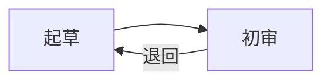
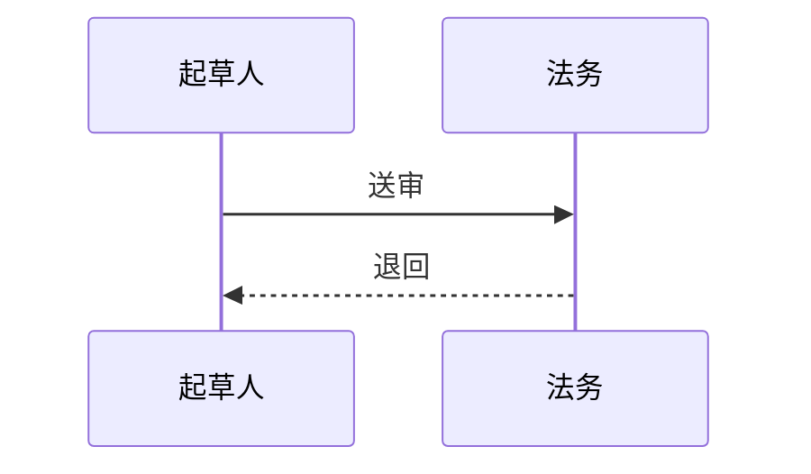
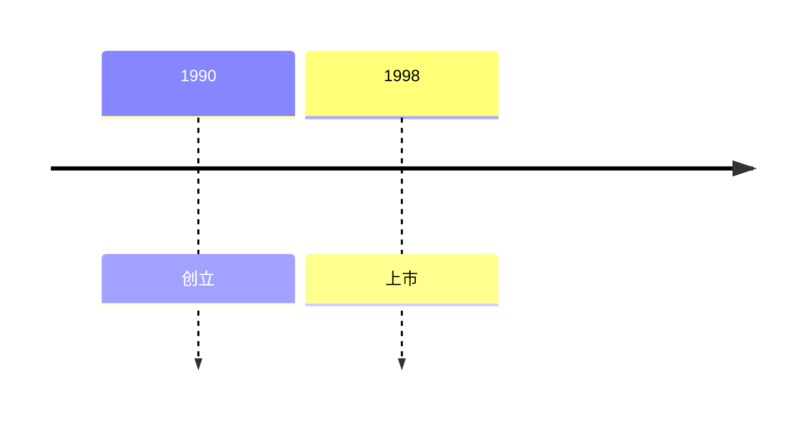
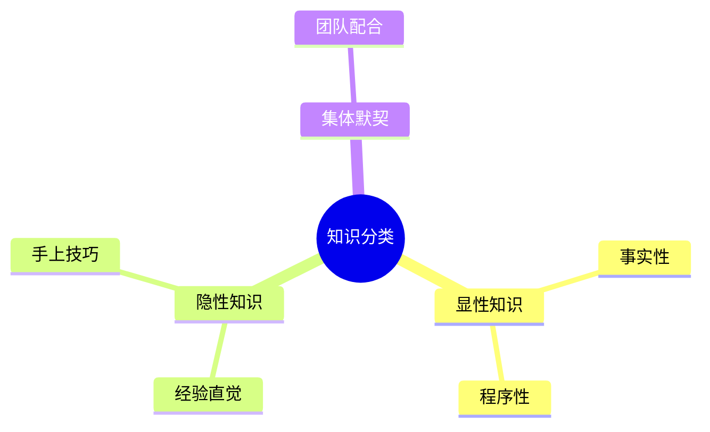
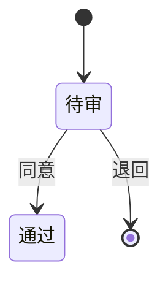
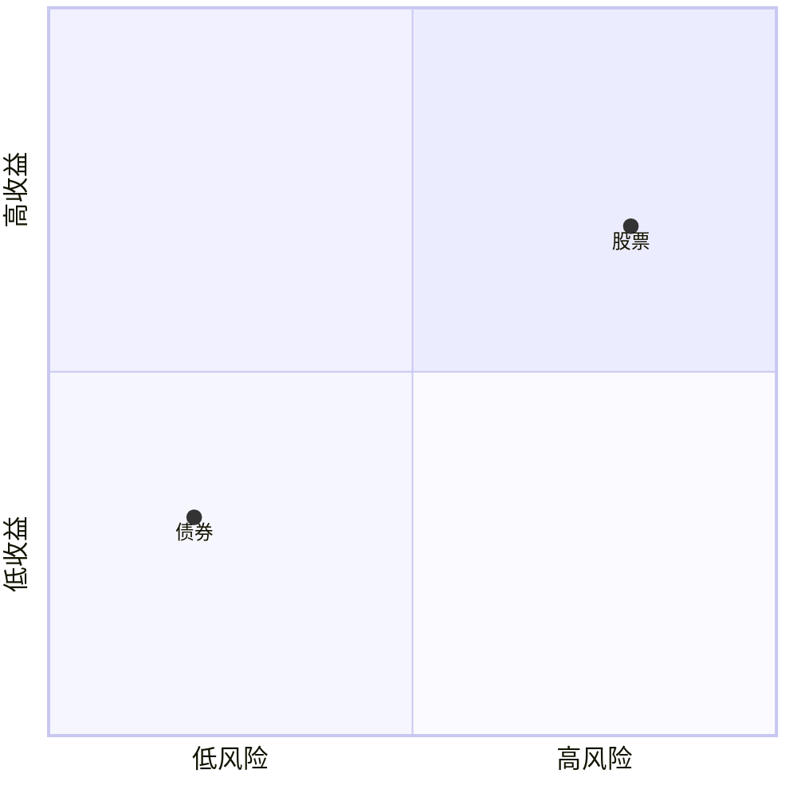
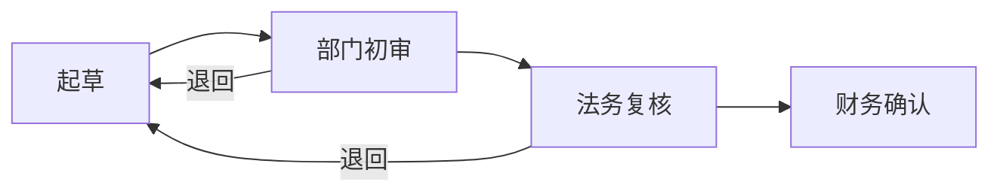

## 可选工具：图示 / 互动块（宁缺毋滥）
阅读器除了正文，还能渲染三种「围栏块」，帮读者把**结构性强或抽象**的内容一眼看懂。它们是工具、不是必答题：纯叙述的章节没有也正常；但只要章节里有一段在讲流程、步骤、阶段、因果、对比、层级、状态或时间线，就应当为它配一个块——只写文字等于让读者自己在脑子里画图。

### 什么时候用、什么时候不用
- 用：≥3 个环节的流程与步骤、阶段划分、因果链、≥2 方的多维对比、时间线、≥4 个角色的关系、概念的定义与层级、状态流转、二维取舍，或一个值得停下来想一想的抽象概念。先把这一段用文字写完整，再在它后面附块。
- 不用：叙述性 / 抒情性的内容（生平、经历、心境、场景描写）——判断标准不是节点多少，而是**内容是不是按时间或情节先后串起来的**：是，就不要画（哪怕串成八、九个节点），那只是把故事换个形状重复一遍。**小说同理**：单线推进的情节、「事件 A → 事件 B → 事件 C」这类串联一律不画；只有人物 / 势力关系错综（≥4 个角色且关系不一目了然）时才画关系图，而且画的是**谁与谁是什么关系**（父子 / 债主 / 联姻 / 旧怨），不是把情节再排一遍。文字三两句已经说清、本章找不到依据的，同样不画。
- 反例（不要这样做）：本章只是在线性地讲一个人的生平（体弱 → 读书 → 得书 → 着迷 → 考学），文字已经交代清楚，此时不要把这些事件串成一张图；也不要把本章没有的内容补进图里，更不要因为画了图就把正文写得更短。

### 选型（先想「这段在讲什么」，再选最小的那个块）
- 流程 / 步骤 / 阶段 / 因果 → mermaid `graph LR`（或 genui `steps`）；时序往返 → mermaid `sequenceDiagram`
- 分类 / 概念层级 → genui `hierarchy`（或 mermaid `mindmap`，至少 3 个分支）；时间线 → genui `timeline`
- ≥2 方的多维对比 → genui `compare`：**只要出现「在几个维度上比较 A 与 B（或 A/B/C）」这种并列对照，就必须用它**——不要画成 mermaid 流程图或树，也不要因为「画不出关系」就不配块；两个维度上的取舍 → mermaid `quadrantChart`
- 抽象概念的定义 / 例子 / 反例 → genui `concept`；并列概念 → genui `cards`
- 分面切换 → genui `tabs`；一句话要点 → genui `callout`
- 同一对象在几种状态间来回 → mermaid `stateDiagram-v2`；人物 / 势力关系 → mermaid `graph TD` 画关系连线；随堂一题 → genui `quiz`（一章最多一题，不要与章末的三个问题重复）
- 只有以上都表达不了、确需交互演示 → html（极少用）

### 硬规则
- 全章最多 2 个块；块放在相关段落**之后**，不要放在最后的问题之后，也不要夹在问题之间。
- 块**不计入字数**，也不能代替文字：字数、论证链条、信息密度的要求只统计文字，不得因为有图就把正文写短。
- 块里的信息必须出自本章，不得编造；块内每条文字不超过 20 字（genui 的 definition / detail / body 可略长，但也要精炼）。
- 围栏独占一行、语言名小写、必须闭合；块内不要再出现三个反引号。
- 系统会逐个校验你写的块并尝试自动修复；拿不准就写简单些，宁可少写一个块。

## 各块写法（参考）
下面是每种块的最小可用骨架：方括号与示例文字换成本章自己的信息，不要照抄示例用词。

### mermaid
首行照抄下列六种图型之一（`graph` 纵向版写 `graph TD`，其余行相同）：






硬要求：节点 ≤ 12 个；节点文字里出现**半角括号 `(` `)` 或引号 `"` 时必须整体用双引号包住**，如 `A["价格(含税)"]`（不加引号会被解析器拒绝，其余标点如冒号、斜杠、全角括号则能解析，但统一加引号最稳）；箭头写 `-->`，不要写 `->`。另外：**mindmap 至少要有 3 个分支**（只有一条链时渲染器会把它拉成一根竖排长条，此时改用 genui `hierarchy` 或 mermaid `graph TD`）。

### genui
围栏内是**一个 JSON 对象**（也可以是对象数组），纯文本：不要注释、不要尾逗号、不要 HTML。**围栏第一行就必须是 `{`**，前面不要加任何一行说明、标题或名称。各类型的必填字段：

流程 / 步骤：
```genui
{"type":"steps","items":[{"label":"试点","detail":"选定 3 个省份"},{"label":"复制","detail":"推广至全国"}]}
```
多维对比（cells 个数与 columns 一致）：
```genui
{"type":"compare","columns":["发债","增发"],"rows":[{"label":"成本","cells":["固定利息","股权稀释"]},{"label":"压力","cells":["到期还本","几乎没有"]}]}
```
时间线：
```genui
{"type":"timeline","items":[{"time":"1990","label":"创立"},{"time":"1998","label":"上市"}]}
```
层级 / 分类（level 从 1 起，用缩进表示包含关系）：
```genui
{"type":"hierarchy","items":[{"label":"成本","level":1},{"label":"固定成本","level":2},{"label":"房租","level":3},{"label":"可变成本","level":2}]}
```
抽象概念（定义 + 例子 + 反例，讲概念时优先用它）：
```genui
{"type":"concept","items":[{"term":"边际成本","definition":"多生产一单位所增加的成本","example":"第 100 件产品的成本","contrast":"固定成本不随产量变化"}]}
```
并列概念卡片：
```genui
{"type":"cards","items":[{"title":"沉没成本","body":"已经付出、无法收回","tag":"概念"},{"title":"机会成本","body":"为选择而放弃的次优项"}]}
```
一句话要点（tone：info / warn / key）：
```genui
{"type":"callout","tone":"key","title":"本章要点","body":"规模效应以边际成本递减为前提；边际成本回升时扩张反而侵蚀利润。"}
```
分面切换：
```genui
{"type":"tabs","tabs":[{"label":"财务","body":"现金流是生命线。"},{"label":"组织","body":"权责要清晰。"}]}
```
随堂一题（answer 是选项下标，从 0 起，必须落在 options 范围内）：
```genui
{"type":"quiz","question":"学步期最大的风险是？","options":["缺钱","过度扩张","没客户"],"answer":1,"explain":"学步期容易盲目多元化。"}
```

### html
只写片段，样式与脚本内联，不引用外链，不用 iframe / form / link / meta；没有网络、不能存取页面之外的任何东西。
```html
<div style="display:flex;gap:8px;align-items:center"><button id="b">切换</button><span id="t">甲</span></div>
<script>document.getElementById('b').onclick=function(){var t=document.getElementById('t');t.textContent=t.textContent==='甲'?'乙':'甲'}</script>
```

### 三段完整示例（先有文字，再配块）
示例一：流程 → mermaid
……审批要依次经过部门初审、法务复核、财务确认三道关口，任何一道退回都要回到起草人手里重来。


示例二：抽象概念 → genui concept
……作者在这里区分了两个常被混用的概念：沉没成本是已经付出且无法收回的支出，决策时不该计入；机会成本是为这个选择而放弃的次优选项，恰恰必须计入。
```genui
{"type":"concept","items":[{"term":"沉没成本","definition":"已经付出、无法收回的支出","example":"已投入的研发费用","contrast":"决策时应忽略，却常被用来为继续投入辩护"},{"term":"机会成本","definition":"为当前选择而放弃的次优选项的价值","example":"用这笔钱买债的利息","contrast":"看不见，但必须计入决策"}]}
```

示例三：多方对比 → genui compare（文字已把对照说完，块只是把同一组维度摆齐）
……作者把三种定价策略放在一起比较：撇脂定价起量慢但单位利润高，渗透定价抢市场快却难以再涨价，跟随定价最安全却永远拿不到超额收益。
```genui
{"type":"compare","columns":["撇脂定价","渗透定价","跟随定价"],"rows":[{"label":"价格水平","cells":["高开","低开","贴着对手"]},{"label":"主要风险","cells":["教育市场成本高","后期难涨价","利润被锁死"]}]}
```
