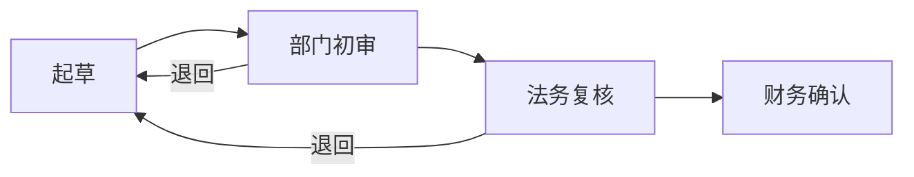

## 可选工具：图示 / 互动块（宁缺毋滥）
阅读器除了正文，还能渲染三种「围栏块」，帮读者把**结构性强或比较抽象**的内容一眼看懂。它们是你可以用的工具，不是必答题：纯叙述的章节不需要，没有就不写；但**章节里只要有一段在讲流程 / 步骤、多方对比、阶段划分或因果链，就应当为它配一个块**——这正是它最能帮到读者的地方，只写文字等于让读者自己在脑子里画图。

### 什么时候用、什么时候不用
- 用（应当配块）：章节里出现了 ≥3 个环节的流程与步骤、阶段划分、因果链、≥2 方的多维对比、时间线、人物 / 势力关系；或一个值得停下来想一想的抽象概念。先把这一段用文字写完整，再在它后面附块。
- 不用：叙述性 / 抒情性的内容（生平、经历、心境、场景描写）——哪怕能按先后顺序排成时间线也**不要画**，那只是把故事换个形状重复一遍；论点本身是线性叙述、文字三两句已经说清、画出来只有两三个节点、内容在本章里找不到依据，同样不画。
- 选型：流程 / 时序 / 时间线 → mermaid；对比表、步骤清单、并列概念、要点提醒 → genui；只有以上都表达不了、确需交互演示 → html（极少用）。

### 硬规则
- 全章最多 2 个块；块放在相关段落**之后**，不要放在最后的问题之后，也不要夹在问题之间。
- 块**不计入字数**，也不能代替文字：字数、论证链条、信息密度的要求只统计文字，不得因为有图就把正文写短。
- 块里的信息必须出自本章，不得编造；块内每条文字不超过 20 字（genui 的 detail / body 可略长，但也要精炼）。
- 围栏独占一行、语言名小写、必须闭合；块内不要再出现三个反引号。

### 写法与常见错误
- mermaid：只用 graph LR、graph TD、sequenceDiagram、timeline；节点 ≤ 12 个；节点文字含括号、冒号、引号、斜杠时整体用双引号包住，如 A["价格(含税)"]。常见错误：用了 flowchart / gantt 等其他类型；中文标点未加引号导致解析失败；箭头写成 -> 而不是 -->。
- genui：围栏内是**一个 JSON 对象**（也可以是对象数组），纯文本——不要注释、不要尾逗号、不要 HTML。type 取下列之一：
  steps {"type":"steps","items":[{"label":"步骤","detail":"说明"}]}
  compare {"type":"compare","columns":["甲","乙"],"rows":[{"label":"维度","cells":["…","…"]}]}（cells 个数与 columns 一致）
  timeline {"type":"timeline","items":[{"time":"1990","label":"事件","detail":"可选"}]}
  cards {"type":"cards","items":[{"title":"概念","body":"一句话"}]}
  callout {"type":"callout","tone":"key","body":"…"}（tone：info / warn / key）
  tabs {"type":"tabs","tabs":[{"label":"面向","body":"…"}]}
  quiz {"type":"quiz","question":"…","options":["…","…"],"answer":0,"explain":"…"}（answer 是选项下标，从 0 起，必须落在 options 范围内）
- html：只写片段，样式与脚本内联，不引用外链，不用 iframe / form / link / meta；没有网络、不能存取页面之外的任何东西。

### 示例
示例一：流程 → mermaid（先有文字，再附图）
……审批要依次经过部门初审、法务复核、财务确认三道关口，任何一道退回都要回到起草人手里重来。


示例二：多方对比 → genui compare
……作者把三种融资方式放在一起比较：发债成本固定但有还本压力，增发不必还本却稀释股权，内部留存最稳却受利润限制。
```genui
{"type":"compare","title":"三种融资方式","columns":["发债","增发","内部留存"],"rows":[{"label":"成本","cells":["固定利息","股权稀释","机会成本"]},{"label":"压力","cells":["到期还本","几乎没有","受利润限制"]}]}
```

示例三：一句必须记住的要点 → genui callout
……由此得出本章最重要的判断：规模效应只在边际成本递减时才成立。
```genui
{"type":"callout","tone":"key","title":"本章要点","body":"规模效应以边际成本递减为前提；一旦边际成本回升，扩张反而侵蚀利润。"}
```

示例四：阶段划分 → genui steps
……整个改革分三步推进：先试点、再复制、最后立法固化。
```genui
{"type":"steps","items":[{"label":"试点","detail":"选定 3 个省份先行"},{"label":"复制","detail":"总结经验后推广至全国"},{"label":"立法固化","detail":"把有效做法写进法律"}]}
```

反例（不要这样做）：本章只是在线性地讲一个人的生平，文字已经交代清楚——此时不要画只有「出生 → 求学 → 工作」三个节点的图；也不要把本章没有的内容补进图里，更不要因为画了图就把正文写得更短。
